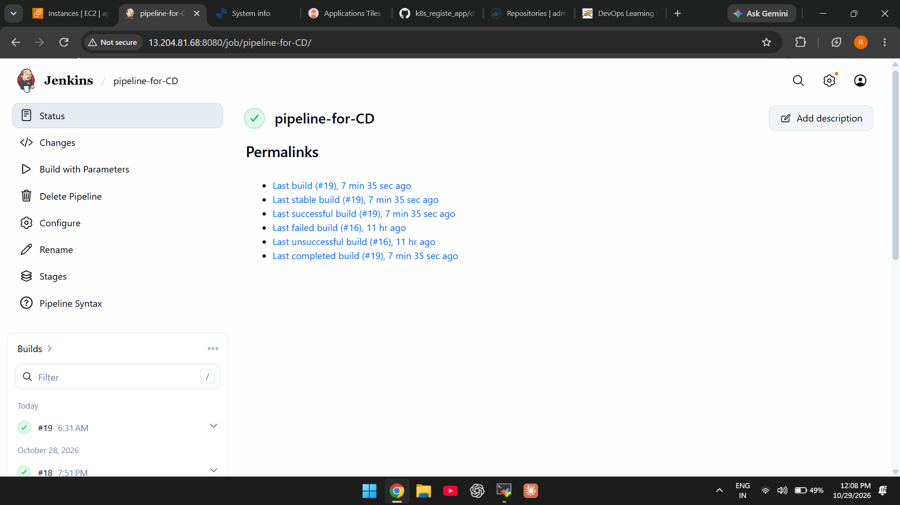
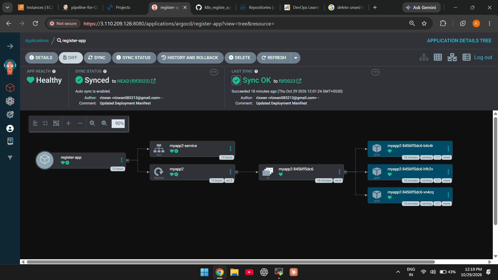
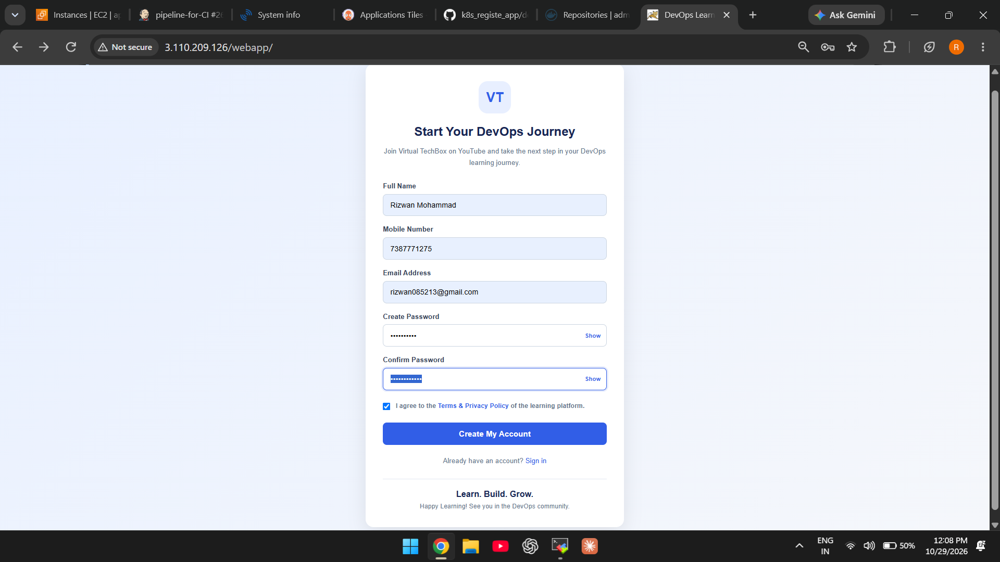

# Registration App — CD and Kubernetes

This repository stores the Kubernetes manifests and Jenkins pipeline used to update the registration app's image. Argo CD watches the repository and syncs committed manifest changes to the cluster.

## Repositories

- **Application + CI:** https://github.com/rizwancloud/registration_app_code
- **Kubernetes + CD:** https://github.com/rizwancloud/k8s_registe_app

## Deployment flow

1. Jenkins job `pipeline-for-CD` receives `IMAGE_NAME` and `IMAGE_TAG` from CI.
2. The CD pipeline updates the image reference in `deployment.yaml` and pushes the change to `main`.
3. Argo CD detects the Git change and synchronizes the desired state.
4. Kubernetes performs a rollout of the application Pods.

## Main files

- `JenkinsFile` — CD pipeline (capitalization is as stored in this repository).
- `deployment.yaml` — Deployment `myapp2`, 3 replicas, container port `8080`.
- `service.yaml` — Service `myapp2-service`, port `80`, target port `8080`, NodePort `30080`.

## Verify the rollout

Run these commands with the same Kubernetes user/context that created the Kind cluster (the supplied lab setup used `sudo`):

```bash
sudo kubectl get deployment,pods,svc
sudo kubectl rollout status deployment/myapp2
sudo kubectl get pods -l app=myapp2
sudo kubectl logs -l app=myapp2 --tail=100
```

The example application was accessed at `/webapp/`. The notes use `sudo kubectl port-forward svc/myapp2-service 80:80 --address 0.0.0.0`; this requires the port-forward process and suitable EC2 security-group access to remain active. The manifest also defines NodePort `30080`, which is a separate access method.

## Documentation

For complete infrastructure setup, CI/CD workflow, configuration,
deployment instructions, and troubleshooting, see the
[Project Documentation](docs/PROJECT_DOCUMENTATION.md).

## Project Screenshots

### Jenkins Pipeline CD Status


### Argocd Deployment and Kubernetes Workloads status


### Application Running


**Important:** The CD job also needs the Jenkins credential ID `github` with permission to push to `main`.
